# FantilatorOS

Operating system for the great Fantilator.

- **Why?** It was summer at CERN and 3rd floor open offices would get pretty hot with no air conditioning or windows to open. As a result, partially because of need, partially because of overflowing creativity, the Fantilator was born!

- **What?** 64 80mm desktop computer case fans, controlled by Arduino Nano using PWM. Has a cute 0.96" screen, three buttons and a key switch.

- **Power supply?** Some server 1U power supply, 1000W or 1200W.

- **Noise?** Only when run at more than ~30%.

- **Control?** Left and right sides can be controlled independently.

- **Did you use it?** Hell yeah! Nothing better than sitting in an office with it running at 3-5%.

- **Can it fly away?** No, but it bends backwards like a banana when run at max speed.

[Featured on HackerNews](https://news.ycombinator.com/item?id=37641706) 🚀

Unfortunately, people without sense of humor took down the official [Fantilator page](https://onlyfans.web.cern.ch/) with its history. You can find slightly reworded copy below.

## History

| Date       | Picture or Video                        | Comment |
|------------|-----------------------------------------|---------|
| 2018-07-30 | 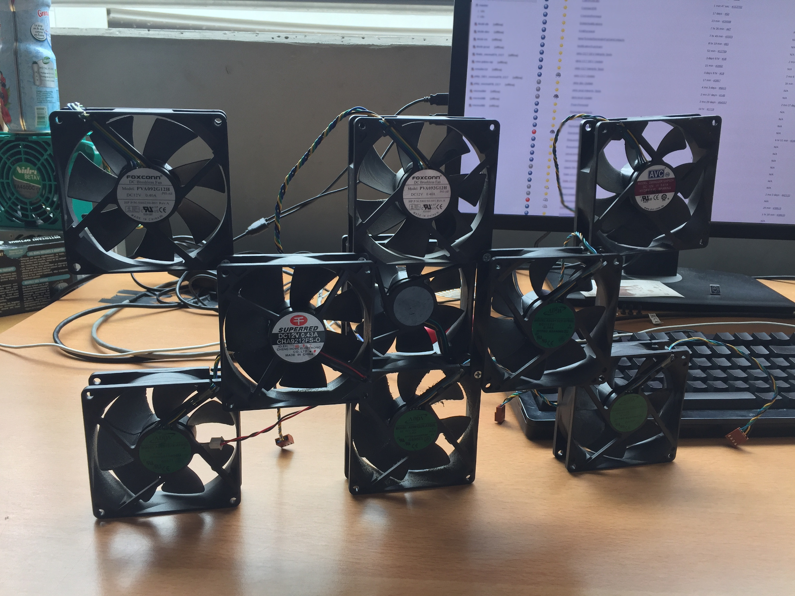     | Idea of connecting multiple fans together in order to create something bigger. Note that even though this contraption has checker board pattern, there is an attempt to cover the "hole" in the center. Each layer of fans is stacked on each other, so overall thickness is three fans. Size - 9 fans. |
| 2018-08-01 | 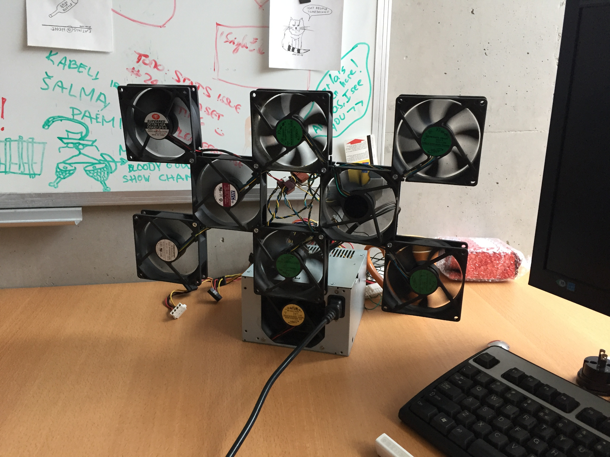     | Improved design where rows overlap each other so overall thickness is just a little bit over single fan. First power supply (200-300w) is added. First running model, however does not have a name yet. Size - 8 fans. |
| 2018-08-01 | 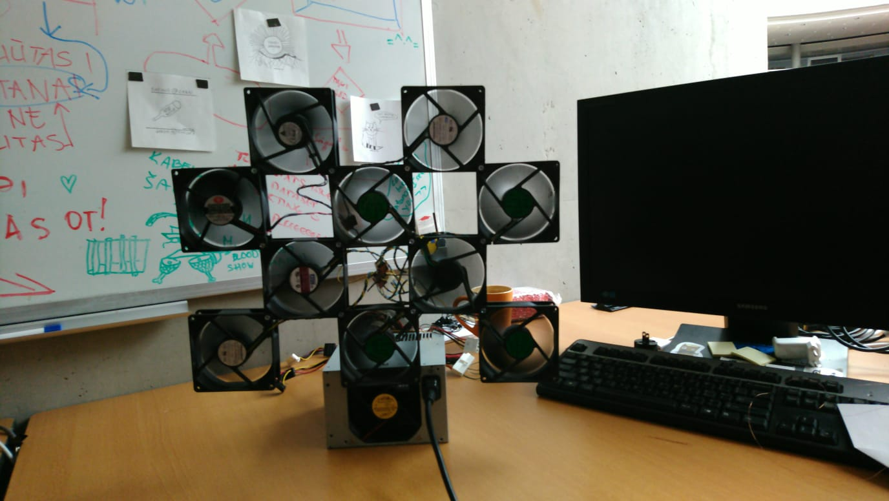 | The design proves to be scalable and grows fast. Size - 10 fans. |
| 2018-08-16 | 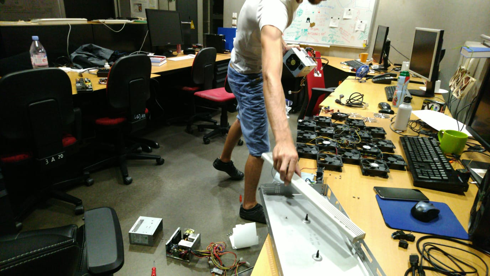     | More fans are added. In addition, potential designs for the Fan Base are evaluated including the case (white) that is currently used. Size - 17 fans. |
| 2018-08-17 | 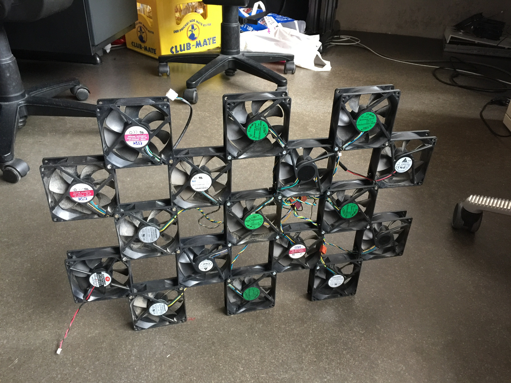     | Fan matrix. Size - 17 fans. |
| 2018-08-25 | 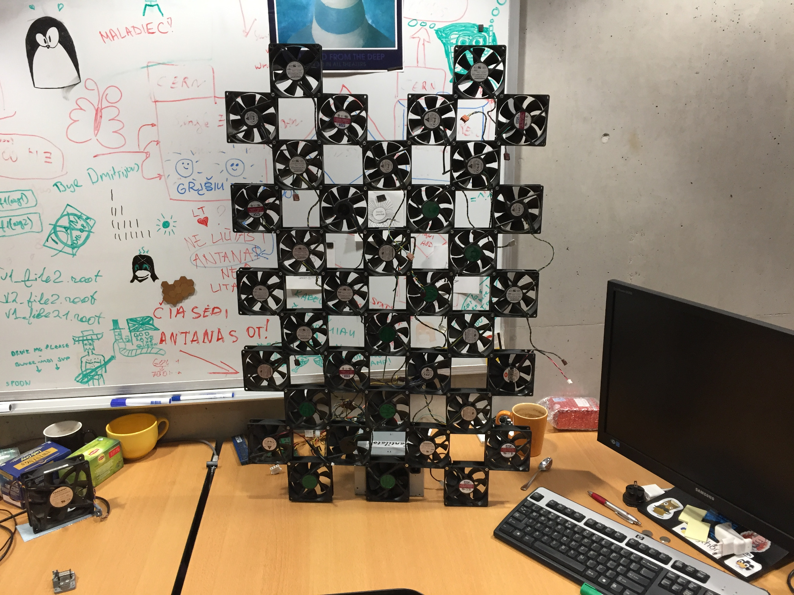     | Bigger fan matrix. Power supply built-in fan is removed and power supply is now cooled by the Fantilator array. Note a piece of paper on power supply with "Fantilator" on it. Fantilator is tied to a table using a cable so it would not tip over. Size - 37 fans. |
| 2018-09-11 | [2018-09-11](media/2018_09_11.mp4)      | Fans connected using proper 4 pin splitters. Size - 37 fans. |
| 2018-09-28 | 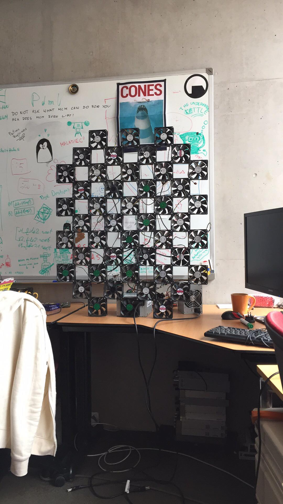     | Even bigger fan matrix. One power supply was not enough to power all fans, so second one was added. Size - 46 fans. |
| 2018-12-10 | 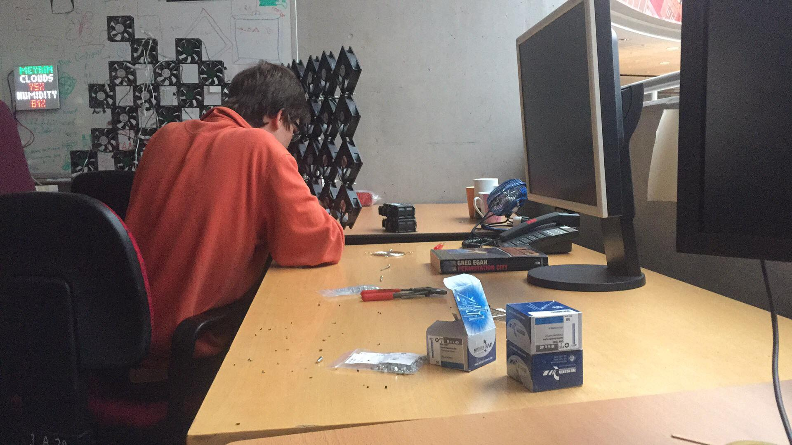     | A very interesting and rare photo that shows how old fantilator is being disassembled while new one is assembled. Old design was perpendicular to table, new one is diagonal. Old fantilator remains are decorated with white Christmas lights. |
| 2018-12-11 | 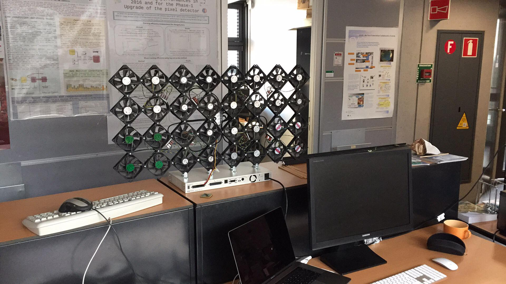     | Phase I of new Fantilator design. The first design to be **thoroughly planned before execution**. Four fans attached together in a plus shape form a "cross" and are connected via 1-to-4 4 pin splitter. 8 crosses (2x4, 32 fans total) form a "cluster" and other ends of "crosses" splitters are connected to 1-to-10 "cluster" splitter. New design has better cable management, proper cable splitters, better base known as Fanbase, threshold for fan power (>=0.4 amps). Size - 32 fans (one "cluster"). |
| 2019-05-10 | 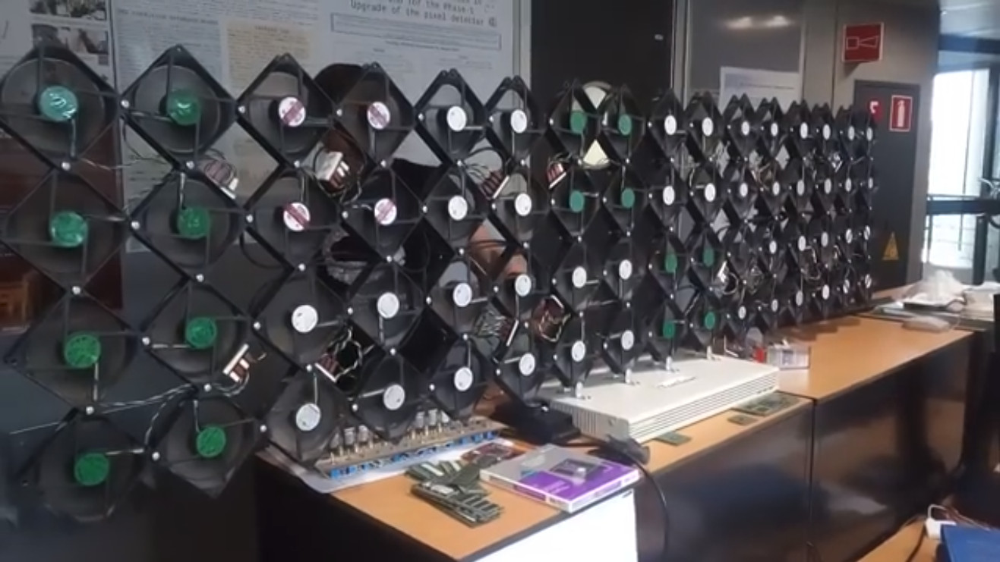     | Phase II expansion completed, doubling the size. Size - 64 fans. |
| 2019-05-29 | [2019-05-29](media/2019_05_29.mp4)      | First attempt to control a single fan using PWM with Arduino Nano. |
| 2019-06-16 | 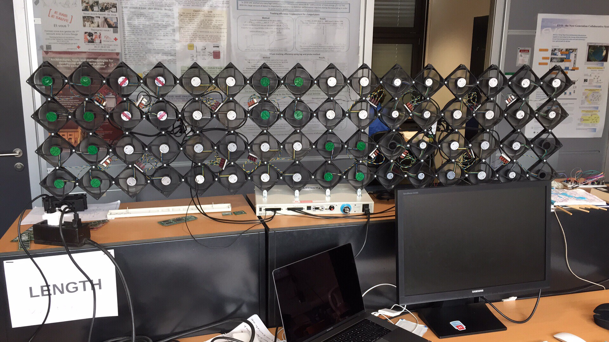     | Fantilator running all fans controlled by Arduino running **FantilatorOS**. Size - 64 fans. |

## See it in action

Video taken by one of the legends in the office:
https://github.com/justinasr/FantilatorOS/assets/10719524/f9a25c5a-0c30-4fe9-881f-4a9c8e4b7c8e
